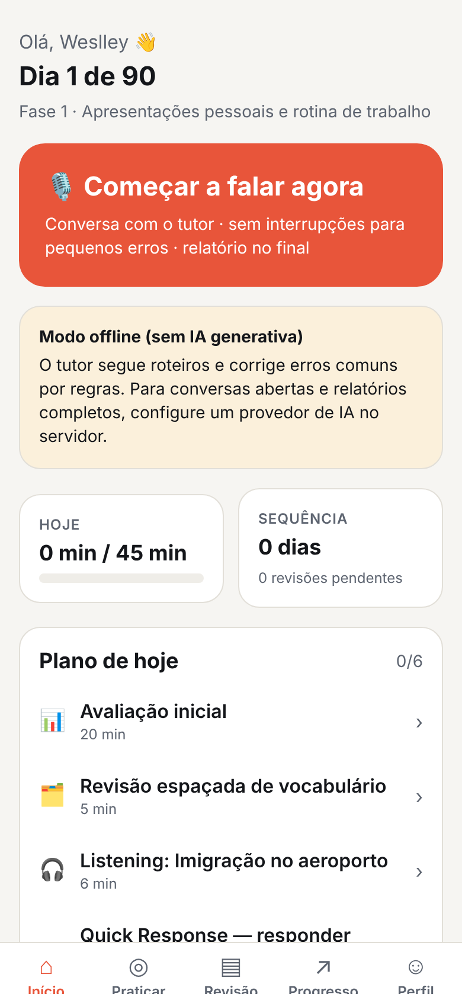
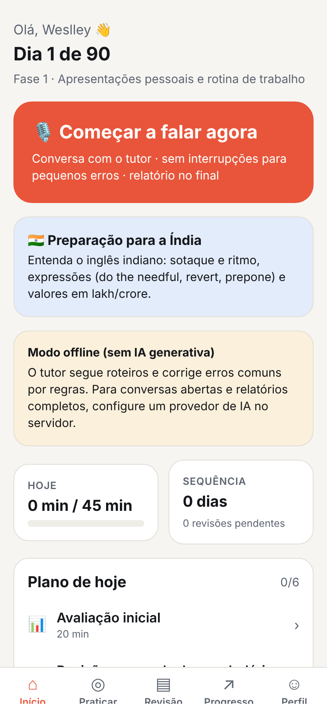
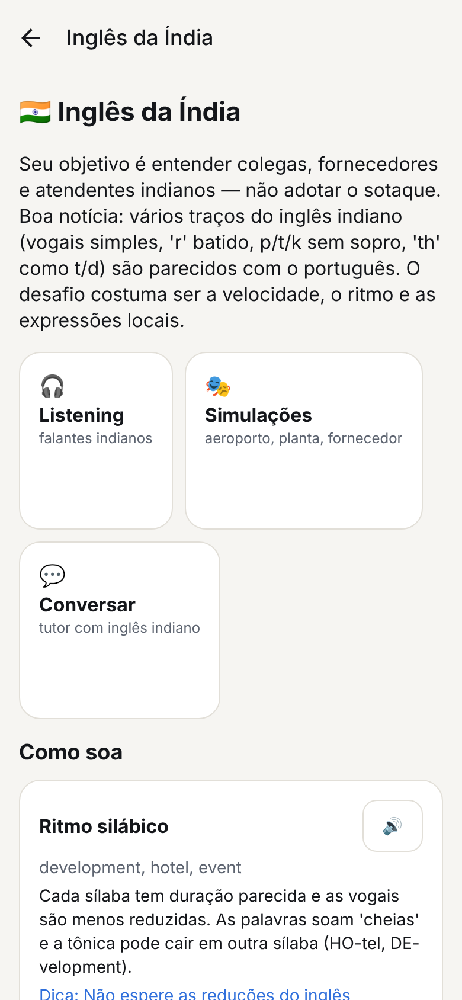
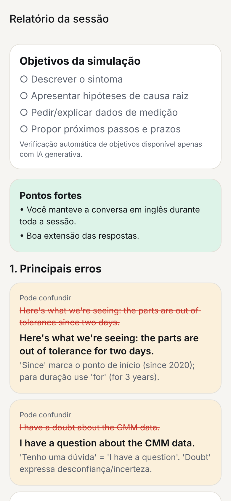

# Fluent AI — plataforma inteligente de aprendizagem de idiomas

**Fale mais, traduza menos.** Professor particular de IA, parceiro de conversação, treinador de pronúncia e simulador de
situações reais de viagem e trabalho, com um **Programa Intensivo de Inglês Profissional de 90 dias** e preparação
específica para o destino da viagem — começando pela **Índia (entender o inglês indiano)**.

<p>
  
  
  
  
</p>

> Sem promessa de fluência: o progresso é medido a cada 15 dias com descritores CEFR (estimativas internas, não certificação),
> e o plano se ajusta ao desempenho.

## O que tem aqui

| Área | Destaques |
|---|---|
| **Tutor de IA** | Conversa por voz ou texto; modos natural (sem interrupções), correção imediata, *No Portuguese*, Quick Response, simulações e *Conversation Challenge* (3–30 min); relatório com erros, frases corrigidas, expressões mais naturais, vocabulário, recomendações e exercícios; memória entre sessões |
| **Destravar a Fala** | Quick Response com janela adaptativa, Think in English, construção de frases progressiva |
| **Plano de 90 dias** | 3 fases com metas mensuráveis, avaliações a cada 15 dias, motor adaptativo explicável, data e destino da viagem |
| **Índia** | 6 diálogos com falantes indianos, 5 simulações (Bengaluru/Pune), tutor com inglês indiano, 30 expressões (do the needful, revert, prepone…), treino de valores em lakh/crore, guia de pronúncia e comunicação no trabalho |
| **Memória** | FSRS-5 (verificado contra a implementação de referência) com recuperação ativa; seus erros viram cartões |
| **Ouvir e pronunciar** | Listening com 4 sotaques e velocidade ajustável; shadowing com feedback de inteligibilidade, ritmo e pausas (inconclusivo quando o áudio não permite avaliar) |
| **Engenharia** | Vocabulário e cenários de BOM, desenhos técnicos, tolerâncias, SolidWorks, SAP, troubleshooting, fornecedores; documentos próprios → exercícios, com bloqueio de material confidencial e redação de dados pessoais |
| **Multilíngue** | Inglês completo (MVP); trilhas iniciais com estratégias próprias para espanhol, italiano, mandarim e japonês |
| **Privacidade** | Consentimentos granulares, áudio descartado por padrão, retenção configurável, exportação e exclusão (LGPD) |

## Estrutura

```
backend/   API FastAPI (Python 3.12), PostgreSQL, Alembic, provedores de IA, testes e evals
mobile/    App Expo (React Native + Expo Router, TypeScript) — iOS, Android e Web
docs/      Estratégia pedagógica, arquitetura, MVP/roadmap, segurança, custos, implantação, testes
```

## Início rápido

```bash
# API (SQLite em desenvolvimento; PostgreSQL em produção)
cd backend && cp .env.example .env && uv sync && uv run uvicorn app.main:app --reload --port 8000

# App
cd mobile && npm install && npm start
```

Ou `docker compose up --build` (PostgreSQL + API). Detalhes em [docs/06-implantacao.md](docs/06-implantacao.md).

**Sem nenhuma chave de API** o app funciona em modo offline (claramente sinalizado): plano, FSRS, listening, drills,
avaliação objetiva, simulações roteirizadas e correções por regras. Para conversa aberta com IA, voz no servidor e vozes neurais
com sotaque (inclusive en-IN), configure os provedores — veja [docs/05-provedores-e-custos.md](docs/05-provedores-e-custos.md).

## Documentação
1. [Estratégia pedagógica](docs/01-estrategia-pedagogica.md) — metodologias, Destravar a Fala, 90 dias, Índia, motor adaptativo
2. [Arquitetura](docs/02-arquitetura.md) — stack, módulos, dados, pipeline do tutor, escalabilidade
3. [MVP e roadmap](docs/03-mvp-e-roadmap.md) — o que está pronto, o que depende de credenciais, próximos passos
4. [Segurança e privacidade](docs/04-seguranca-privacidade.md)
5. [Provedores e custos](docs/05-provedores-e-custos.md)
6. [Instalação e implantação](docs/06-implantacao.md)
7. [Testes e qualidade](docs/07-testes-e-qualidade.md)

## Qualidade
- Backend: 111 testes (SQLite) + suíte de API contra PostgreSQL, migrações verificadas, lint.
- App: typecheck, testes de lógica e build web; fluxo ponta a ponta verificado com Playwright.
- Harness de avaliação do feedback corretivo e do reconhecimento de voz (`backend/evals/`).
- CI: [.github/workflows/ci.yml](.github/workflows/ci.yml).
