# Fluent AI — plataforma inteligente de aprendizagem de idiomas

**Fale mais, traduza menos.** Professor particular de IA, parceiro de conversação, treinador de pronúncia e simulador de
situações reais de viagem e trabalho, com um **Programa Intensivo de Inglês Profissional de 90 dias** e preparação
específica para o destino da viagem — começando pela **Índia (entender o inglês indiano)**.

<p>
  
  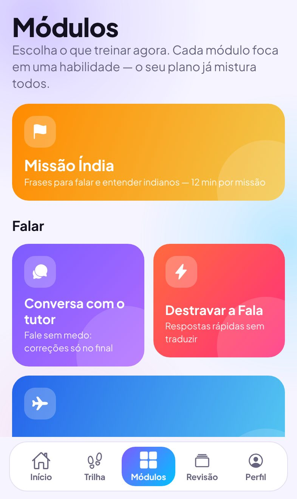
  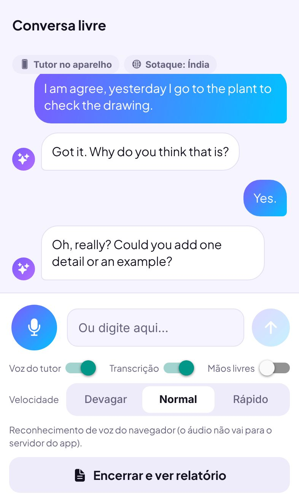
  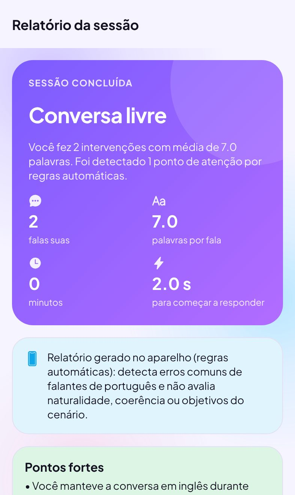
</p>
<p>
  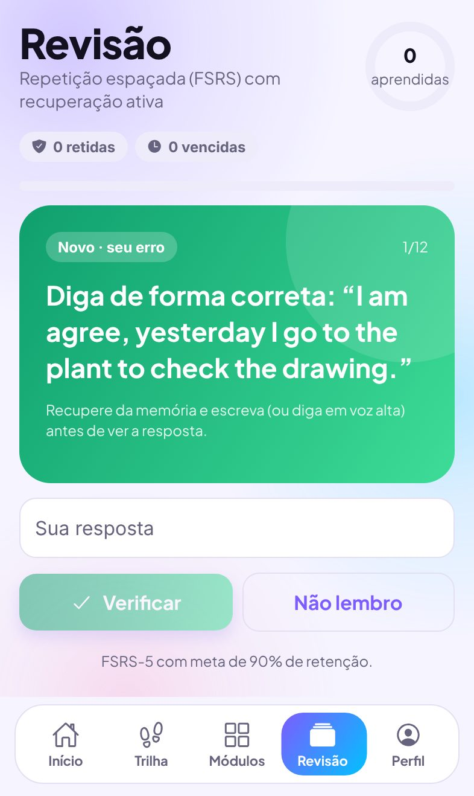
  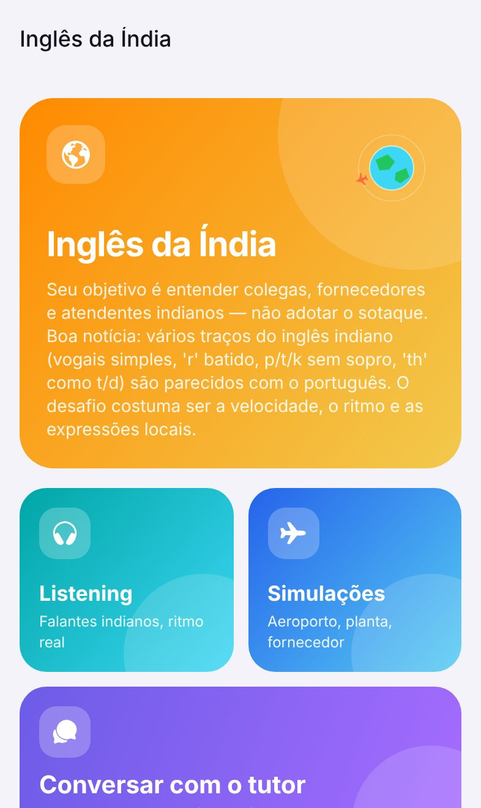
  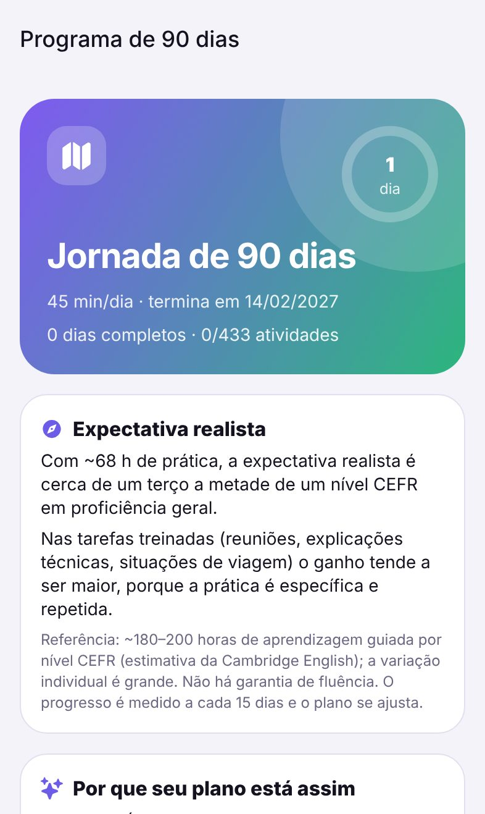
  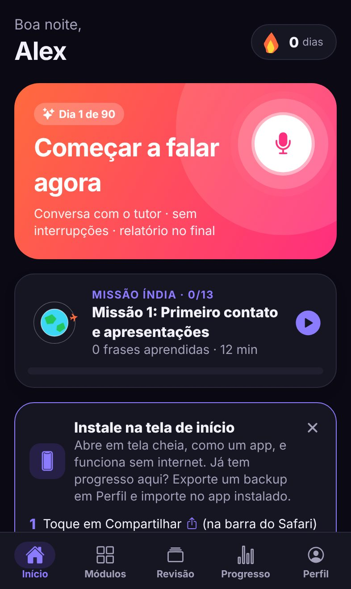
</p>

## 📱 Instalar no iPhone de graça

O app é um **PWA**: publique no GitHub Pages (grátis), abra o link no Safari e toque em
**Compartilhar → Adicionar à Tela de Início**. Abre em tela cheia, funciona **offline** e guarda seus dados no próprio
aparelho — sem App Store, sem conta de desenvolvedor e sem servidor. Passo a passo em
**[docs/08-instalar-no-iphone.md](docs/08-instalar-no-iphone.md)**.

## ✨ Visual: temas, motion e animações do After Effects

5 temas (Aurora, Oceano, Pôr do sol, Floresta, Clássico) no claro e no escuro; fundo com luzes em movimento, barra de abas
com pílula animada, parallax, transições com mola e o mascote **Fluo** em animações Lottie (formato do After Effects).
Detalhes em **[docs/11-tema-e-animacoes.md](docs/11-tema-e-animacoes.md)**.

<p>
  
  
  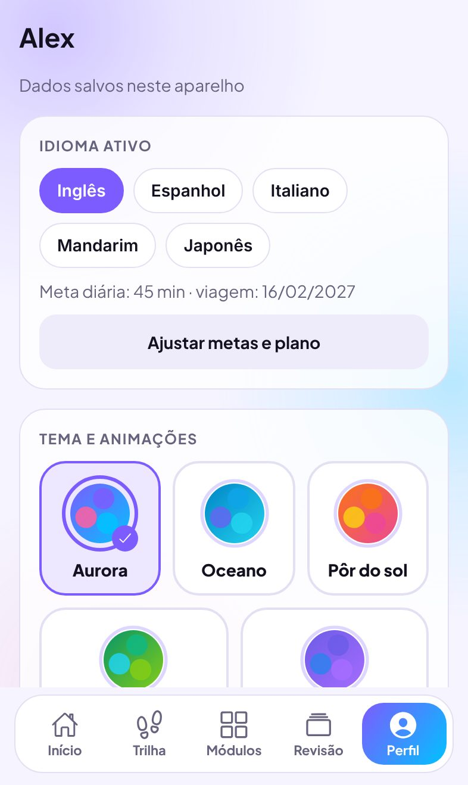
  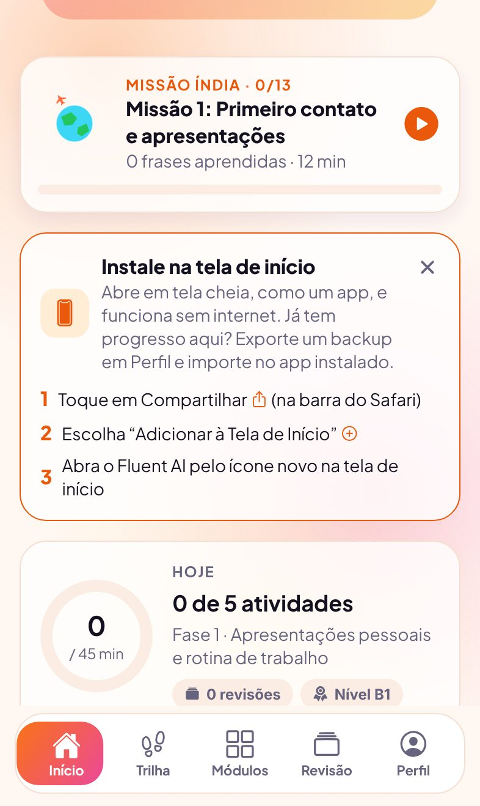
</p>

## 🎯 Trilha — lições curtas para aprender e fixar

Aba com caminho de **97 lições de ~3 min** (32 unidades, 322 frases e palavras): escolher significado, montar frases com
blocos, ouvir e montar, completar, juntar pares e falar/digitar. XP, meta diária, sequência de dias e combo; os erros
voltam no fim da lição e tudo vai para a revisão espaçada. Detalhes em **[docs/10-trilha.md](docs/10-trilha.md)**.

<p>
  
  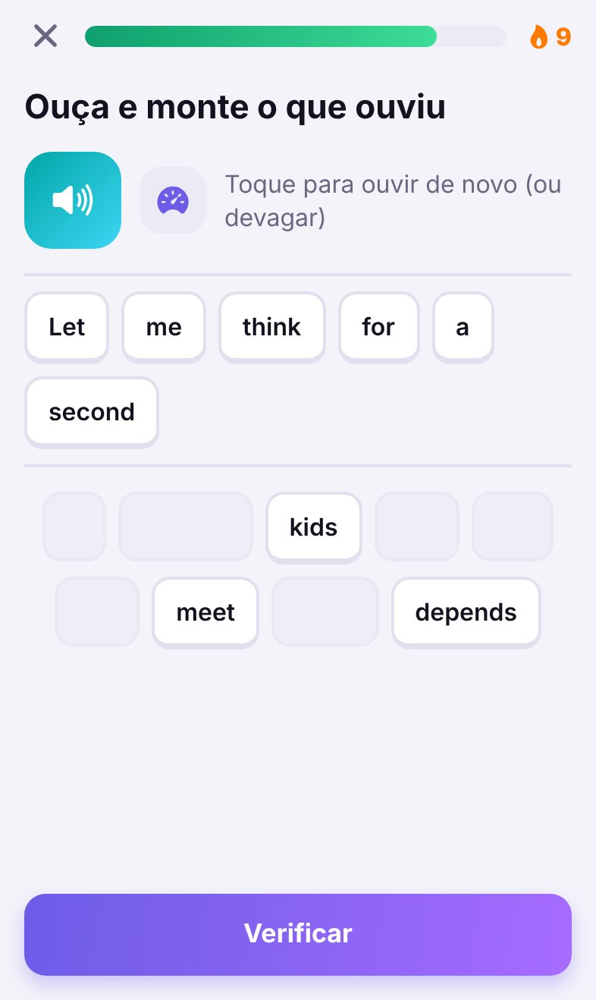
  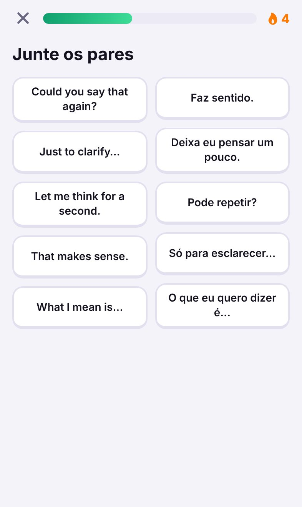
  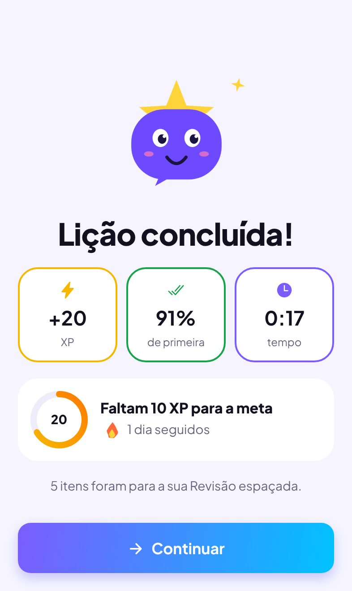
</p>

## 🇮🇳 Missão Índia — falar e entender indianos rápido

13 missões de ~12 minutos (130 frases) com voz em inglês indiano: **Ouvir → Falar → Entender → Conversar**, e cada frase
vai para a revisão espaçada. Apresentações, o inglês indiano do dia a dia, reuniões e calls, e-mails (*kindly revert*,
*PFA*), imigração, transporte, hotel e chip, refeições, visita à planta, prazos e o "não" indireto, lakh/crore e preços,
erros típicos de brasileiros e palavras em hindi. Também dá para **colar frases do seu próprio material** e transformá-las
em cartões. Detalhes em **[docs/09-missao-india.md](docs/09-missao-india.md)**.

<p>
  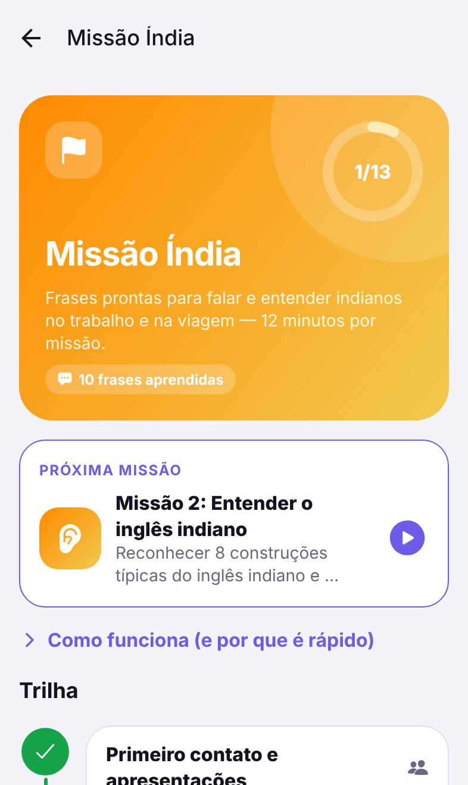
  
  
  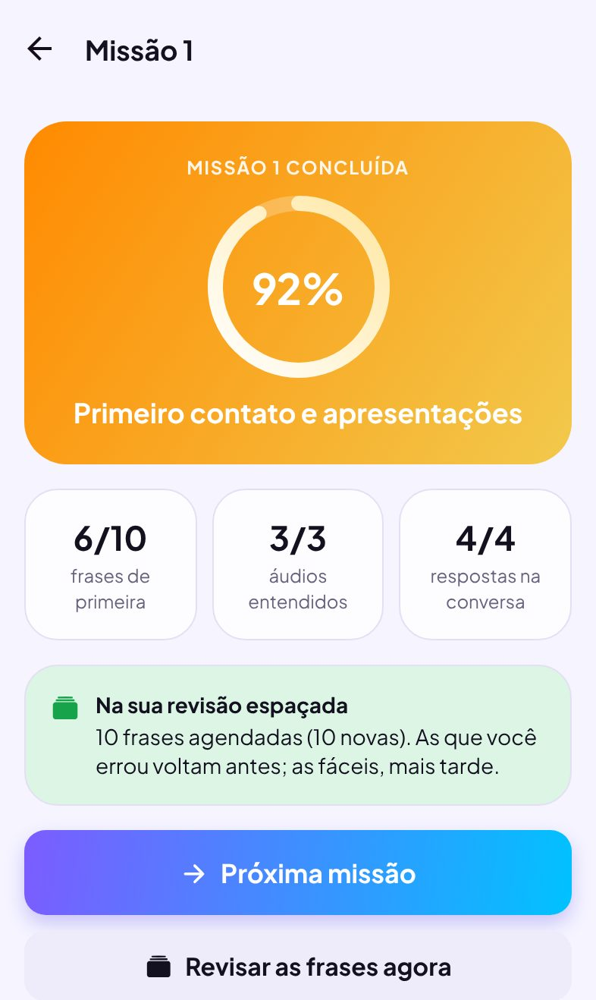
</p>

> Sem promessa de fluência: o progresso é medido a cada 15 dias com descritores CEFR (estimativas internas, não certificação),
> e o plano se ajusta ao desempenho.

## O que tem aqui

| Área | Destaques |
|---|---|
| **Tutor** | IA generativa com o servidor configurado; no modo local, roteiros + correção por regras (sinalizado no app). Conversa por voz ou texto; modos natural (sem interrupções), correção imediata, *No Portuguese*, Quick Response, simulações e *Conversation Challenge* (3–30 min); relatório com erros, frases corrigidas, expressões mais naturais, vocabulário, recomendações e exercícios; memória entre sessões |
| **Destravar a Fala** | Quick Response com janela adaptativa, Think in English, construção de frases progressiva |
| **Plano de 90 dias** | 3 fases com metas mensuráveis, avaliações a cada 15 dias, motor adaptativo explicável, data e destino da viagem |
| **Turbo** | Sessão diária de 15 min: lembrar em voz alta com intervalos crescentes, shadowing, fluência 4/3/2 e confiança antes/depois com desafio real |
| **Mapas mentais** | 8 mapas (96 frases) com 3 modos — Explorar, Lembrar e Reconstruir de memória — e revisão espaçada do mapa inteiro |
| **Como eles falam** | Guias da Índia e dos EUA (Wisconsin): pronúncia, fala rápida, gírias, estilo de conversa e sotaques, com áudio e treino de ouvido |
| **Medidor de fala** | 1 min por semana com palavras/min, variedade e português no meio; registro de conversas com pessoas reais |
| **Missão Wisconsin** | 6 missões para a viagem de trabalho aos EUA: imigração, inverno, unidades americanas, reuniões e small talk do Meio-Oeste |
| **Trilha** | 97 lições curtas gamificadas (XP, meta diária, sequência, combo) com 7 tipos de exercício; erros voltam no fim; itens vão para o FSRS |
| **Missão Índia** | 13 missões curtas (130 frases) em sequência: ouvir com voz indiana, falar do português para o inglês, entender e conversar; frases vão para o FSRS; entram no plano diário quando o destino é Índia; importação das suas próprias frases |
| **Índia** | 6 diálogos com falantes indianos, 5 simulações (Bengaluru/Pune), tutor com inglês indiano, 30 expressões (do the needful, revert, prepone…), treino de valores em lakh/crore, guia de pronúncia e comunicação no trabalho |
| **Memória** | FSRS-5 (verificado contra a implementação de referência) com recuperação ativa; seus erros viram cartões |
| **Ouvir e pronunciar** | Listening com 4 sotaques e velocidade ajustável; shadowing com feedback de inteligibilidade, ritmo e pausas (inconclusivo quando o áudio não permite avaliar) |
| **Engenharia** | Vocabulário e cenários de BOM, desenhos técnicos, tolerâncias, SolidWorks, SAP, troubleshooting, fornecedores; documentos próprios → exercícios, com bloqueio de material confidencial e redação de dados pessoais |
| **Multilíngue** | Inglês completo (MVP); trilhas iniciais com estratégias próprias para espanhol, italiano, mandarim e japonês |
| **Experiência** | 5 temas com fundo animado, barra de abas animada, parallax, mascote Fluo e animações Lottie (formato do After Effects), flashcards com flip, anéis de progresso, celebrações, hápticos, modo escuro, opção de animações reduzidas |
| **Modo local** | Sem servidor: plano, FSRS, tutor por roteiros e regras, avaliação e relatórios rodam no aparelho (TypeScript com testes de paridade contra o backend); backup em JSON |
| **Privacidade** | Consentimentos granulares, áudio descartado por padrão, retenção configurável, exportação e exclusão (LGPD) |

## Estrutura

```
backend/   API FastAPI (Python 3.12), PostgreSQL, Alembic, provedores de IA, testes e evals
mobile/    App Expo (React Native + Expo Router, TypeScript) — iOS, Android, Web e PWA (modo local em src/lib/local/)
docs/      Estratégia pedagógica, arquitetura, MVP/roadmap, segurança, custos, implantação, testes
```

## Início rápido

```bash
# API (SQLite em desenvolvimento; PostgreSQL em produção)
cd backend && cp .env.example .env && uv sync && uv run uvicorn app.main:app --reload --port 8000

# App
cd mobile && npm install && npm start
```

Ou `docker compose up --build` (PostgreSQL + API). Detalhes em [docs/06-implantacao.md](docs/06-implantacao.md).

**Sem `EXPO_PUBLIC_API_URL`** o app roda em **modo local** (tudo no aparelho, sem servidor) — é assim que ele é publicado
como PWA. **Com o servidor e sem nenhuma chave de API**, funciona em modo offline (claramente sinalizado): plano, FSRS, listening, drills,
avaliação objetiva, simulações roteirizadas e correções por regras. Para conversa aberta com IA, voz no servidor e vozes neurais
com sotaque (inclusive en-IN), configure os provedores — veja [docs/05-provedores-e-custos.md](docs/05-provedores-e-custos.md).

## Documentação
1. [Estratégia pedagógica](docs/01-estrategia-pedagogica.md) — metodologias, Destravar a Fala, 90 dias, Índia, motor adaptativo
2. [Arquitetura](docs/02-arquitetura.md) — stack, módulos, dados, pipeline do tutor, escalabilidade
3. [MVP e roadmap](docs/03-mvp-e-roadmap.md) — o que está pronto, o que depende de credenciais, próximos passos
4. [Segurança e privacidade](docs/04-seguranca-privacidade.md)
5. [Provedores e custos](docs/05-provedores-e-custos.md)
6. [Instalação e implantação](docs/06-implantacao.md)
7. [Testes e qualidade](docs/07-testes-e-qualidade.md)
8. [Instalar no iPhone sem custo](docs/08-instalar-no-iphone.md) — PWA no GitHub Pages, modo local, limites
9. [Missão Índia](docs/09-missao-india.md) — trilha rápida de frases para falar e entender indianos
10. [Trilha](docs/10-trilha.md) — lições curtas gamificadas para aprender e fixar
11. [Tema e animações](docs/11-tema-e-animacoes.md) — temas, motion, Lottie (After Effects) e acessibilidade
12. [Turbo](docs/12-turbo.md) — sessão diária com os métodos mais eficazes para fixar e falar sem medo
13. [Mapas mentais e Missão Wisconsin](docs/13-mapas-e-wisconsin.md) — fixação por reconstrução de memória e preparação para os EUA
14. [O sistema integrado](docs/14-sistema-integrado.md) — plano diário com tudo junto, dois destinos e medidor de fala semanal
15. [Como eles falam](docs/15-como-eles-falam.md) — pronúncia, gírias, sotaques e estilo de conversa na Índia e nos EUA

## Qualidade
- Backend: 120 testes (SQLite) + suíte de API contra PostgreSQL, migrações verificadas, lint.
- App: typecheck, testes de lógica e de paridade com o backend (FSRS, analisador de erros, plano, avaliação, shadowing),
  build web e PWA; fluxo ponta a ponta (boas-vindas → plano → tutor → relatório → revisão → offline) verificado com
  Playwright em viewport de iPhone.
- Harness de avaliação do feedback corretivo e do reconhecimento de voz (`backend/evals/`).
- CI: [.github/workflows/ci.yml](.github/workflows/ci.yml); publicação do PWA: [.github/workflows/pages.yml](.github/workflows/pages.yml).
