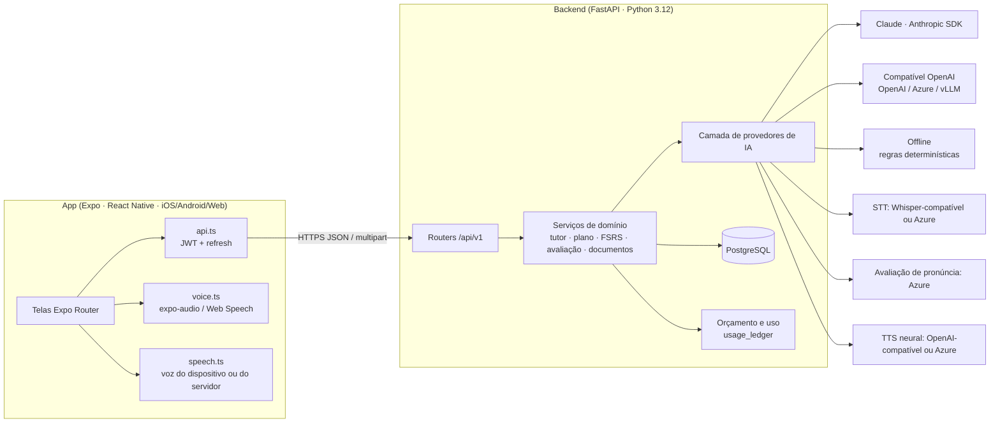
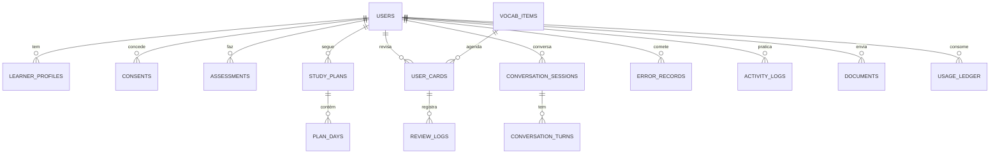

# 2. Arquitetura

## 2.1 Visão geral



## 2.2 Escolhas tecnológicas

| Camada | Escolha | Por quê |
|---|---|---|
| App | **React Native + Expo (SDK 58) + Expo Router** | TypeScript em todo o front; uma base para iOS, Android e Web; módulos oficiais para áudio (`expo-audio`), voz (`expo-speech`) e armazenamento seguro (`expo-secure-store`); builds/atualizações OTA via EAS. Flutter seria igualmente viável, mas o ecossistema JS/TS facilita compartilhar tipos e integrar SDKs de voz e realtime (WebRTC/LiveKit) usados na Fase 2. |
| API | **Python 3.12 + FastAPI** | Async nativo (chamadas de IA são I/O longas), validação com Pydantic v2, OpenAPI automático, ecossistema de IA/NLP em Python. |
| Banco | **PostgreSQL 16** (SQLAlchemy 2 async + Alembic) | Relacional para usuários/planos/cartões, JSONB para relatórios e configurações. SQLite só para testes locais. |
| Autenticação | Argon2id + JWT curto (15 min) + refresh opaco com rotação e detecção de reuso | Senhas com KDF resistente a GPU; tokens de acesso curtos; refresh armazenado só como hash, revogação por família. No celular, tokens ficam no Keychain/Keystore. |
| IA (texto) | Camada de provedores; padrão **Claude (`claude-opus-5-5`)** via SDK oficial | Saída estruturada por JSON Schema (respostas sempre parseáveis), `effort` baixo para conversa e médio para relatórios, cache de prompt, fallback do servidor para recusas. Trocável por qualquer API compatível com OpenAI ou pelo modo offline. |
| Voz | STT Whisper-compatível ou Azure; TTS do dispositivo (padrão, gratuito) ou neural; avaliação de pronúncia Azure | Cada peça é opcional e informada ao app via `/system/capabilities` — nada é exibido como operacional sem estar configurado. |
| Repetição espaçada | **FSRS-5** próprio, verificado contra py-fsrs | Controle total de persistência/logs; `review_logs` permite otimizar os 19 parâmetros por usuário no futuro. |

## 2.3 Módulos do backend

```
backend/app/
  main.py            app, middleware (request id, cabeçalhos de segurança, logs sem conteúdo), lifespan
  config.py          configuração via ambiente (.env); produção exige JWT_SECRET forte
  models.py          18 tabelas (usuários, consentimentos, perfis, avaliações, planos, cartões, sessões, erros, uso…)
  security.py        Argon2, JWT, refresh com rotação, rate limit
  ai/                base.py (interfaces) · anthropic_provider · openai_compat · azure_speech · registry · audio
  services/
    fsrs.py          algoritmo FSRS-5
    vocab.py         cartões, sessões de revisão, recuperação ativa, estatísticas de retenção
    assessment.py    banco de itens, estimativa CEFR por competência, rubrica de fala (IA) ou heurística
    planner.py       gerador do plano (fases, metas, interleaving, escada do Challenge, avaliações a cada 15 dias)
    adaptive.py      sinais de desempenho → ajustes explicáveis
    plans.py         persistência e readaptação do plano
    tutor.py         sessões, turnos, memória entre sessões, relatório, caderno de erros
    tutor_prompts.py prompts e JSON Schemas (independentes de fornecedor)
    offline_tutor.py tutor determinístico (sem IA generativa)
    error_analyzer.py regras de interferência PT→EN (+ falsos amigos PT→ES)
    speech_metrics.py fluência e feedback de shadowing com controle de confiança
    drills.py        Quick Response, Sentence Building, listening, revisão de erros
    documents.py     extração, bloqueio de confidenciais, redação de PII, anti prompt injection
    usage.py         orçamento diário por usuário e teto global de custo
    dashboard.py     agregações (esforço × domínio)
  content/           conteúdo pedagógico (vocabulário, itens CEFR, listening, cenários, drills, outros idiomas)
  routers/           auth · me (perfil/consentimentos/exportação/exclusão) · content · learning · tutor · speech · documents
```

## 2.4 Modelo de dados (resumo)



## 2.5 Pipeline do tutor

1. O app envia texto **ou** áudio (`/tutor/sessions/{id}/audio`); áudio → STT → texto (com métricas de fluência a partir dos tempos das palavras).
2. Regras de interferência do português analisam a frase (grátis, instantâneo).
3. O LLM recebe: prompt de sistema (perfil, nível, erros recorrentes, tópicos anteriores, regras do modo/cenário) + histórico (até 40 turnos) e devolve **JSON validado**: `reply`, `corrections`, `new_vocabulary`, `goals_achieved`, `comprehension_issue`.
4. Correções são mescladas (a IA prevalece quando analisou a mesma frase — reduz falso positivo de regra) e exibidas **somente** conforme o modo.
5. A resposta é falada pela voz do dispositivo (ou neural do servidor). Em mãos livres, o microfone reabre ao fim da fala.
6. No encerramento, um relatório estruturado é gerado; erros vão para o caderno de erros e os principais viram cartões FSRS.
7. Se o provedor falhar, a sessão **degrada para o modo offline** e o app informa.

### Latência e tempo real

O MVP usa voz em turnos (gravar → enviar → responder), com latência típica de 2–5 s dependendo do provedor e da rede. Conversa
full-duplex em tempo real (interrupções, *barge-in*) está no roadmap via WebRTC (ex.: LiveKit Agents ou APIs realtime de voz),
reutilizando a mesma camada de prompts e relatórios.

## 2.6 Escalabilidade

- API sem estado (JWT) → escala horizontal atrás de balanceador; `WEB_CONCURRENCY` workers por instância.
- PostgreSQL gerenciado com backups; índices em `(user_id, due)` para cartões e `(user_id, started_at)` para atividades.
- Limitadores em memória (login e IA) são por processo → **em produção com várias réplicas, mover para Redis**.
- Chamadas de IA são o gargalo de custo/latência: orçamento por usuário, teto global e cache de prompt.
