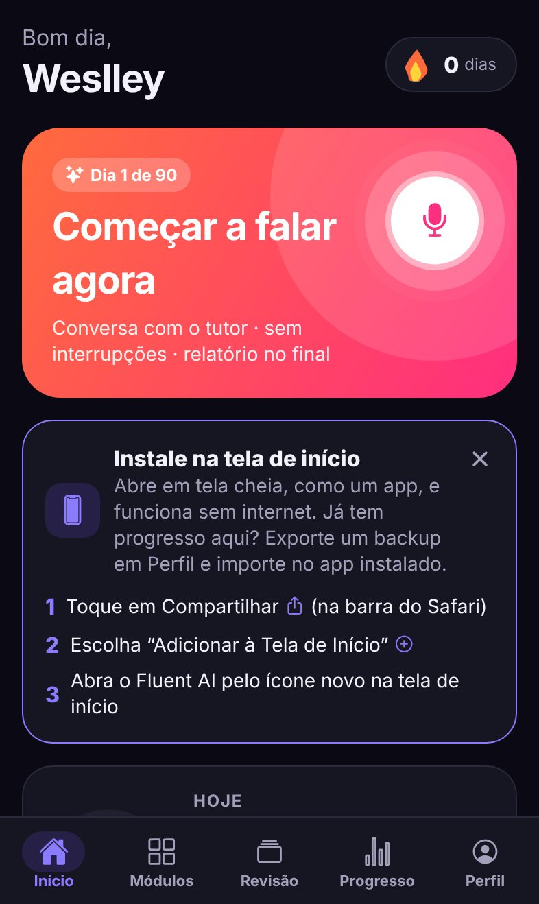

# 8. Instalar no iPhone sem custo

O Fluent AI roda como **PWA** (*Progressive Web App*): você abre um link no Safari, toca em **Adicionar à Tela de Início**
e ele vira um ícone que abre em tela cheia, como um app, **funcionando offline**. Não precisa de App Store, conta de
desenvolvedor Apple (US$ 99/ano), Mac, Xcode nem servidor. A hospedagem é o **GitHub Pages**, gratuito para repositórios
públicos.

<p>
  
  
  
</p>

## Passo 1 — publicar (uma única vez, ~5 minutos)

1. No GitHub, abra o repositório → **Settings → Pages**.
2. Em **Build and deployment → Source**, escolha **GitHub Actions**.
3. Leve o código para o branch `main` (por exemplo, fazendo o merge do pull request deste branch).
   O workflow [`.github/workflows/pages.yml`](../.github/workflows/pages.yml) roda sozinho: testa, gera o PWA e publica.
   Também dá para rodar manualmente em **Actions → Publicar app no GitHub Pages (PWA) → Run workflow** (a partir do `main`).
4. Quando terminar (aba **Actions**, ~3 minutos), o app fica em:

   **`https://<seu-usuario>.github.io/<nome-do-repositório>/`** — neste repositório: `https://weslley11.github.io/zanshin/`

Cada novo push no `main` publica uma versão nova; o app instalado se atualiza sozinho na próxima abertura com internet.

## Passo 2 — instalar no iPhone

1. Abra o link no **Safari**.
2. Toque em **Compartilhar** (quadrado com seta para cima) → **Adicionar à Tela de Início** → **Adicionar**.
3. Abra o **Fluent AI** pelo ícone novo e faça o cadastro rápido (só o nome — sem e-mail nem senha).

> **Instale antes de começar a estudar.** No iPhone, o app da tela de início guarda os dados separado do Safari: o que
> você fizer numa aba comum do Safari não aparece no app instalado. Se já começou no Safari, use
> **Perfil → Backup, privacidade e dados → Exportar backup** e depois **Importar backup** dentro do app instalado.

O app mostra essas instruções sozinho quando é aberto no Safari sem estar instalado.

## O que funciona no modo local (sem servidor)

Tudo roda no próprio iPhone, e os dados ficam só nele:

| Funciona offline | Como |
|---|---|
| Plano de 90 dias, jornada, metas e adaptação | mesmas regras do backend (portadas e testadas contra o Python) |
| Revisão espaçada (FSRS-5) e vocabulário | idem; seus erros viram cartões |
| Tutor de conversa, simulações, Conversation Challenge, Quick Response | **roteiros + correção por regras** (33 regras de interferência português→inglês), relatório no final |
| Listening com sotaques (inclusive indiano), shadowing, Think in English, construção de frases | voz do próprio iPhone para ouvir; inteligibilidade calculada pela transcrição |
| Avaliação inicial e a cada 15 dias | itens objetivos + heurística da fala |
| Backup | exporta/importa um arquivo JSON (Arquivos/iCloud Drive) |

**Limites honestos do modo local**

- **O tutor não é uma IA generativa**: ele segue roteiros e detecta erros comuns por regras. Não entende respostas fora do
  roteiro nem avalia naturalidade. Para conversa aberta com IA é preciso o servidor (ver abaixo).
- **Voz → texto**: o app usa o reconhecimento de voz do navegador quando o iOS o oferece; se não estiver disponível, toque no
  **microfone do teclado** (ditado do iOS, idioma inglês) e fale — funciona do mesmo jeito para treinar.
- **Vozes** com sotaque dependem das vozes instaladas no iPhone (Ajustes → Acessibilidade → Conteúdo Falado → Vozes →
  Inglês; baixe uma voz "Inglês (Índia)" para treinar o sotaque indiano).
- **Documentos técnicos** (upload de PDFs para gerar exercícios) e **notas de pronúncia por fonema** exigem o servidor.
- Se você apagar os dados de sites do Safari ou remover o ícone, o progresso some — faça backup de vez em quando.

## Quero a IA generativa (opcional, pago por uso)

O mesmo app conversa com o backend (`backend/`) quando é gerado com `EXPO_PUBLIC_API_URL` apontando para ele. Aí o tutor
passa a usar o modelo de linguagem configurado, voz no servidor e vozes neurais com sotaque. Isso tem custo de
hospedagem e de API — detalhes em [05-provedores-e-custos.md](05-provedores-e-custos.md) e
[06-implantacao.md](06-implantacao.md).

## Alternativas

- **Expo Go** (grátis, App Store): `cd mobile && npm install && npx expo start`, escaneie o QR code com a câmera do iPhone.
  Útil para desenvolvimento; o app só abre enquanto o computador estiver rodando o servidor de desenvolvimento.
- **App nativo na App Store/TestFlight**: exige a conta de desenvolvedor Apple (paga) e `eas build` — não é necessário
  para usar o Fluent AI.
- **Repositório privado?** O GitHub Pages para repositórios privados exige plano pago. Alternativas gratuitas: Cloudflare
  Pages ou Netlify, publicando a pasta `mobile/dist` gerada por
  `cd mobile && FLUENT_BASE_URL= npm run build:pwa` (sem subcaminho).

## Para desenvolvedores

```bash
cd mobile
npm run build:pwa                          # dist/ servido na raiz do domínio
FLUENT_BASE_URL=/zanshin npm run build:pwa # dist/ servido em /zanshin (GitHub Pages)
npm run icons                              # regenera ícones (requer Playwright)
```

- `scripts/build-pwa.mjs` injeta as metatags do iOS, o manifest e gera o service worker (precache de todo o app,
  versionado pelo conteúdo; páginas: rede primeiro com fallback para o cache após 3,5 s).
- `public/` contém `manifest.webmanifest` e os ícones; `app.config.js` aplica o `baseUrl`.
- Sem `EXPO_PUBLIC_API_URL`, o app entra em **modo local** (`src/lib/local/`), com testes de paridade contra o backend
  (`npm test`). O conteúdo vem de `backend/scripts/export_content.py` (o CI falha se estiver desatualizado).
