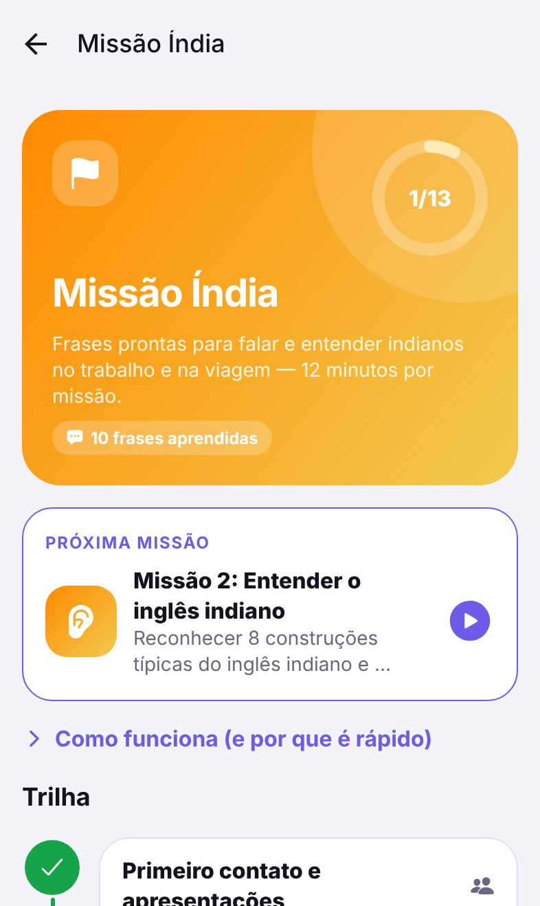
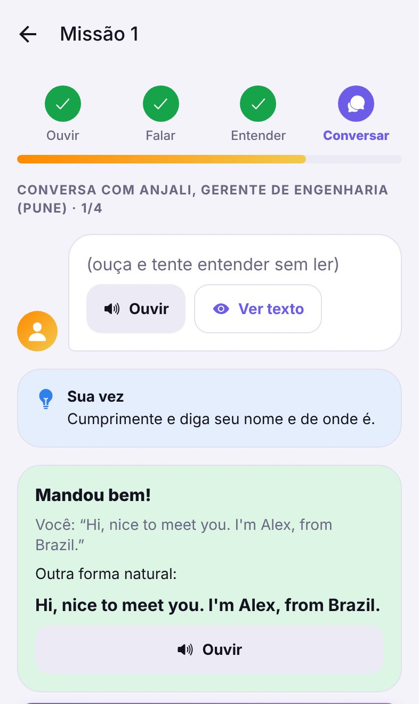
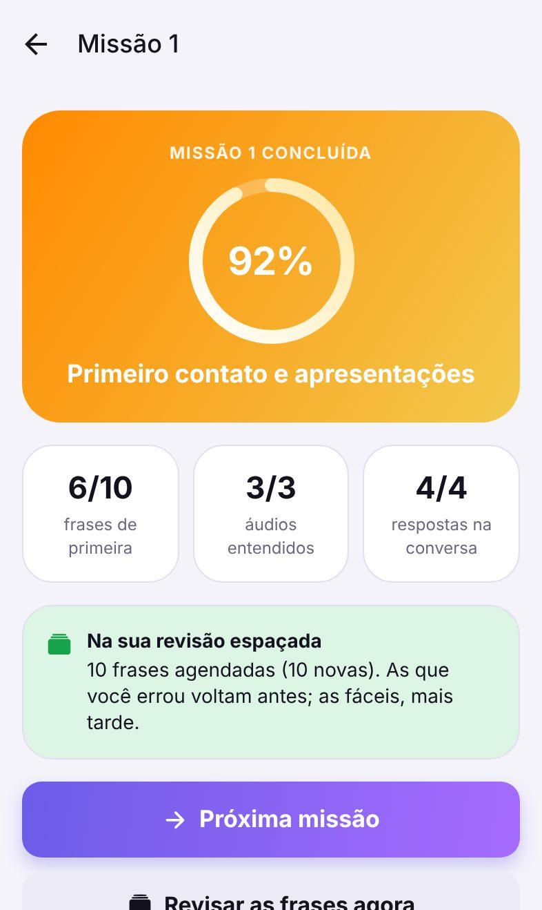

# 9. Missão Índia — falar e entender indianos o mais rápido possível

Trilha de **13 missões curtas (~12 min cada, 130 frases)** para quem vai trabalhar com indianos ou viajar à Índia.
Cada missão ensina **frases inteiras** (chunks) de uma situação real, com voz em inglês indiano, e termina com uma
mini-conversa. Tudo funciona no modo local (PWA no iPhone, offline, grátis).

<p>
  
  
  
  
  
</p>

## As missões

| # | Missão | O que você consegue fazer no fim |
|---|---|---|
| 1 | Primeiro contato e apresentações | Apresentar-se em 30 s e responder às perguntas pessoais comuns na Índia |
| 2 | Entender o inglês indiano | Reconhecer *only/itself*, *do one thing*, *same to same*, *tell me*… e confirmar o que foi dito |
| 3 | Reuniões e calls | Resolver áudio, pedir a palavra, discordar com educação, fechar ações |
| 4 | E-mail e rotina de trabalho | Ler e responder *PFA*, *kindly revert*, *pending from your side*, cobrar com *gentle reminder* |
| 5 | Chegada: imigração e aeroporto | Responder à imigração e sair do aeroporto com segurança |
| 6 | Transporte: cab, auto e direções | Combinar preço/taxímetro, dar direções, informar o OTP |
| 7 | Hotel, chip de celular e dinheiro | Check-in, problemas no quarto, SIM card, cartão e caixa eletrônico |
| 8 | Refeições e convites | Controlar a pimenta, pedir água engarrafada, aceitar/recusar comida com educação |
| 9 | Na planta: visita técnica e qualidade | Segurança, processo, revisão do desenho, rejeição, causa raiz, lote piloto |
| 10 | Prazos e o "não" indireto | Transformar *we will try our level best* em data, responsável e confirmação por e-mail |
| 11 | Números, horários e preços | Lakh/crore, fuso (Índia = Brasília + 8h30), negociar no comércio |
| 12 | Erros que brasileiros cometem | *I agree*, *I'm 35*, *discuss the*, *explain it to me*, *attend*, *intend*, *currently*… |
| 13 | Imprevistos e palavras em hindi | Farmácia, mal-estar, celular perdido; *accha, theek hai, haan ji, chalo, bas, namaste* |

O conteúdo é original (escrito para o app) e fica em
[`backend/app/content/india_missions.py`](../backend/app/content/india_missions.py).

## Como cada missão funciona — e por que é rápido

1. **Ouvir** — as 10 frases, com voz indiana (e opção americana/devagar). Você repete em voz alta.
   *Input compreensível + frases inteiras*: você aprende a frase pronta para usar, não palavras soltas.
2. **Falar** — o app mostra o português (e às vezes toca a fala de um indiano que puxa a resposta) e você **diz a frase
   em inglês**, por voz ou teclado. Frases do tipo "ouvir" pedem que você repita o que ouviu, sem ler.
   *Prática de recuperação*: puxar da memória fixa muito mais do que reler. Quem erra ganha uma segunda chance no fim
   da rodada, com uma dica.
3. **Entender** — áudios curtos do jeito que os indianos falam (*yesterday night*, *myself Rahul*, *lakh*…), com
   pergunta de compreensão e explicação.
4. **Conversar** — mini-conversa de 4 turnos com um personagem (gerente, motorista, recepcionista, fornecedor). A
   correção verifica se você comunicou a ideia, não se usou a frase exata.

No final, **cada frase entra na revisão espaçada (FSRS)** com a nota do seu desempenho: de primeira → volta mais tarde;
errou → volta antes. É isso que transforma "vi uma vez" em "lembro na hora de falar".

## Ritmo recomendado

- **Rotina expressa (20–25 min/dia):** 5 min de Revisão + 1 missão + 3–5 min de Perguntas rápidas de indianos.
- Com destino **Índia** no perfil, as missões já entram no **plano diário** (peso maior na fase 1). Com 45 min/dia,
  as 13 missões cabem nas 3 primeiras semanas; depois o plano as repete para revisão.
- Errou muito? Repita a missão no dia seguinte — a segunda rodada costuma ser bem mais fácil.

## Minhas frases (importar do seu material)

Em **Missão Índia → Minhas frases**, cole frases de qualquer material seu — e-books, anotações, e-mails do trabalho —
uma por linha:

```
Could you send me the invoice? = Você pode me mandar a fatura?
Vou me atrasar 10 minutos | I'll be ten minutes late
```

Aceita `=`, `|`, `—`, `-`, `;` ou tabulação (copiar de planilha); se a tradução vier primeiro, o app inverte. As frases
viram cartões na revisão espaçada. No modo local, nada sai do aparelho.

## Limites honestos

- O app verifica a frase dita com tolerância a pequenos erros e variações comuns, mas **não avalia pronúncia nem
  naturalidade** no modo local. A meta é ser entendido, não imitar o sotaque.
- A voz indiana depende das vozes instaladas no aparelho (iPhone: Ajustes → Acessibilidade → Conteúdo Falado → Vozes →
  Inglês → Índia).
- 13 missões dão uma base sólida para as situações mais comuns; conversas abertas e imprevisíveis continuam exigindo
  prática com pessoas (ou com o tutor de IA, quando há servidor configurado).

## Para desenvolvedores

- API: `GET /api/v1/india/missions`, `GET /api/v1/india/missions/{id}` (personaliza `{name}` com o nome do perfil),
  `POST /api/v1/india/missions/{id}/complete` (`results[]` com nota FSRS 1–4 por frase, `score`, plano).
- Modo local: [`mobile/src/lib/local/missions.ts`](../mobile/src/lib/local/missions.ts); correção em
  [`mobile/src/lib/missions.ts`](../mobile/src/lib/missions.ts); telas em `mobile/src/app/missao/` e `mobile/src/app/frases.tsx`.
- Plano: `india_mission` entra via `DESTINATIONS["IN"]["extra_weights"]` em `planner.py` (espelhado em TypeScript e
  conferido pelo teste de paridade).
- Testes: `backend/tests/test_missions.py` (conteúdo: toda frase e variação é aceita pelo corretor e toda resposta-modelo
  passa nas palavras-chave), `mobile/src/lib/__tests__/missions.test.ts` e o fluxo local em `localApi.test.ts`.
