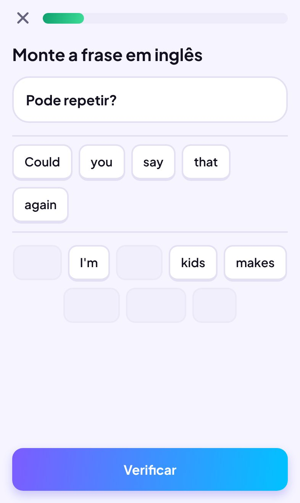
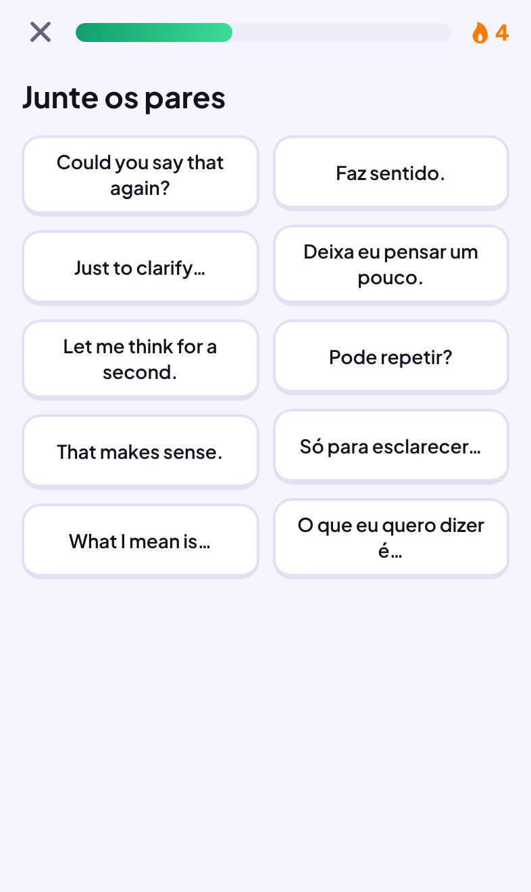
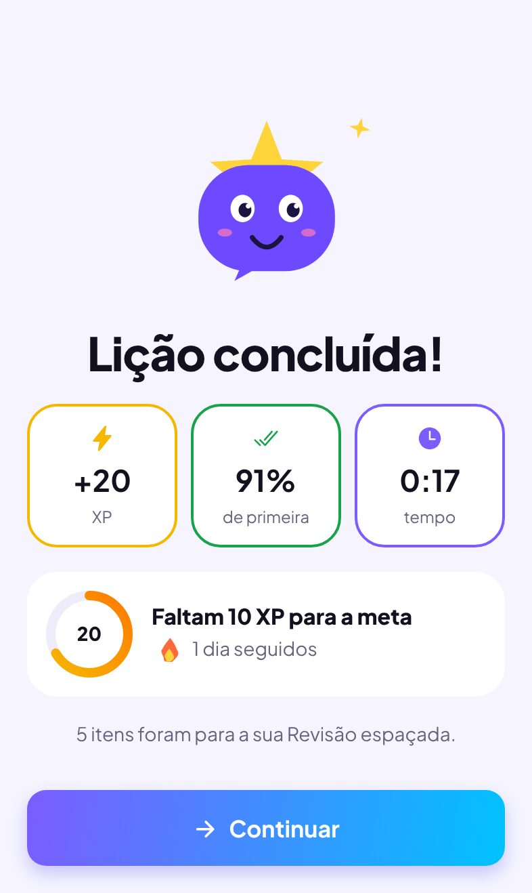

# 10. Trilha — aprender e fixar com lições curtas

Aba **Trilha** (segunda da barra): um caminho de lições curtas, com XP, meta diária e sequência de dias. Mecânica
de curso gamificado com visual próprio do app.

  
  
  
  
  

## Como é

- **32 unidades · 97 lições · 322 frases e palavras**, em ordem de utilidade: frases para destravar a conversa,
  apresentações, inglês indiano, viagem, imigração, transporte, hotel, comida, reuniões, e-mail, corporativo, phrasal
  verbs, expressões indianas, fábrica, vocabulário técnico, prazos, números, erros de brasileiros, colocações, expressões
  idiomáticas…
- Cada unidade: **2 lições de 5 itens novos + 1 revisão** da unidade inteira. A lição seguinte desbloqueia ao concluir a
  anterior.
- **~3 minutos por lição**, 7 a 14 exercícios de 7 tipos:
  1. **O que significa?** — ouve/lê em inglês e escolhe o significado.
  2. **Como se diz em inglês?** — escolhe a frase certa.
  3. **Monte a frase** — toca nos blocos na ordem certa (há blocos "pegadinha").
  4. **Ouça e monte** — só pelo áudio (com botão de velocidade lenta).
  5. **Complete a frase** — escolhe o que falta num exemplo real.
  6. **Junte os pares** — inglês ↔ português.
  7. **Diga ou escreva** — pelo microfone ou teclado, do português para o inglês.
- **Errou?** A resposta certa aparece na hora e o exercício volta no fim da lição.
- **XP:** 10 por lição + 1 por exercício certo de primeira (até +10) + 5 de bônus na lição perfeita.
- **Meta diária:** 20, 30 ou 50 XP (escolha no topo da Trilha). **Sequência:** dias seguidos com lição; concluir uma lição
  ou missão também conta para a sequência da tela inicial.
- **Combo:** acertos seguidos aparecem com uma chama ao lado da barra de progresso.

## Por que fixa (e não é só jogo)

- Cada item novo aparece pelo menos **duas vezes** na lição: primeiro reconhecer, depois produzir (montar, completar,
  dizer) — recuperação ativa e prática intercalada.
- No fim, cada item vai para a **Revisão espaçada (FSRS)** com a nota do seu desempenho: certo de primeira → volta mais
  tarde; errou → volta antes. A Trilha apresenta; a Revisão garante que você não esquece.
- Os exercícios variam a cada vez (sorteio com semente), então refazer uma lição não é decorar a ordem das respostas.

## Para desenvolvedores

- Estrutura: [`backend/app/content/course.py`](../backend/app/content/course.py) (montada a partir do vocabulário e das
  frases da Missão Índia). API: `GET /api/v1/course`, `GET /api/v1/course/lessons/{id}`,
  `POST /api/v1/course/lessons/{id}/complete` (XP calculado no servidor). Modo local:
  [`mobile/src/lib/local/course.ts`](../mobile/src/lib/local/course.ts).
- Gerador de exercícios e correção: [`mobile/src/lib/course.ts`](../mobile/src/lib/course.ts) — o teste
  `mobile/src/lib/__tests__/course.test.ts` gera **todas as 97 lições** e verifica que cada exercício tem solução (blocos
  suficientes, opção correta única, lacuna presente) e que todos os 7 tipos aparecem.
- Telas: `mobile/src/app/(tabs)/learn.tsx` (caminho) e `mobile/src/app/licao/[id].tsx` (lição).
