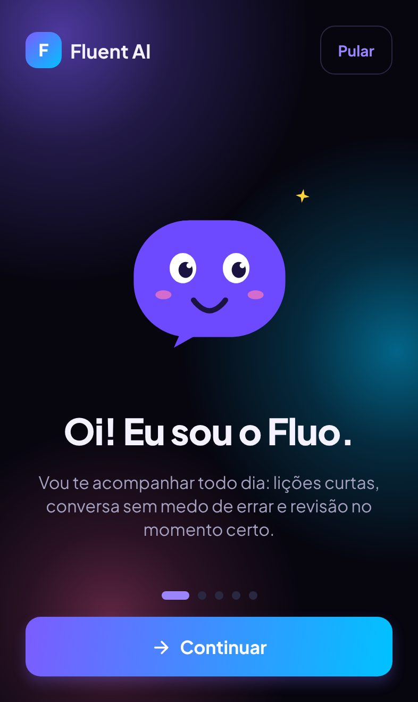
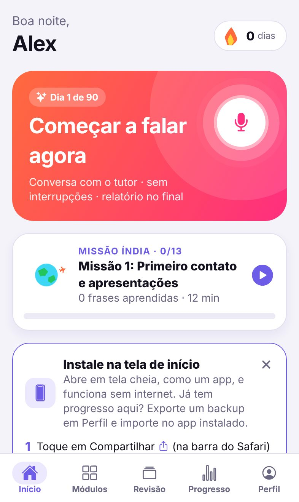
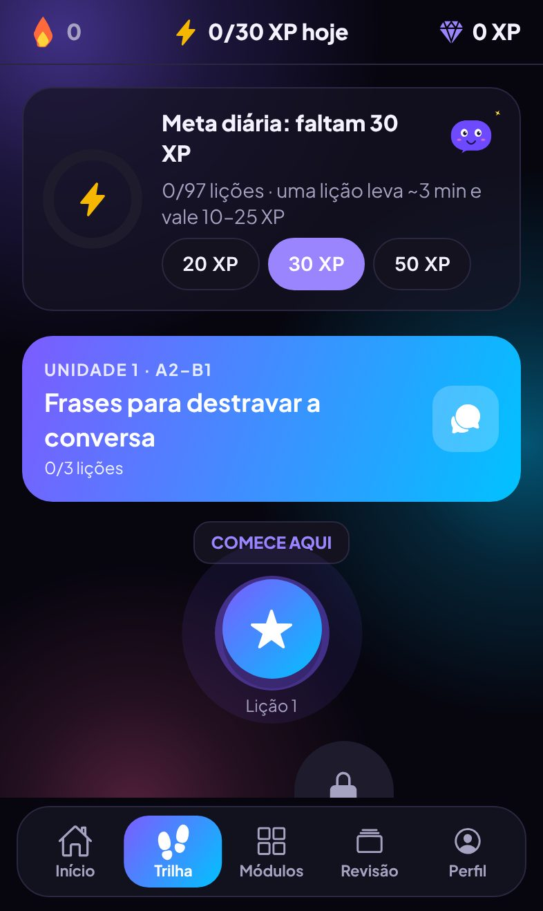
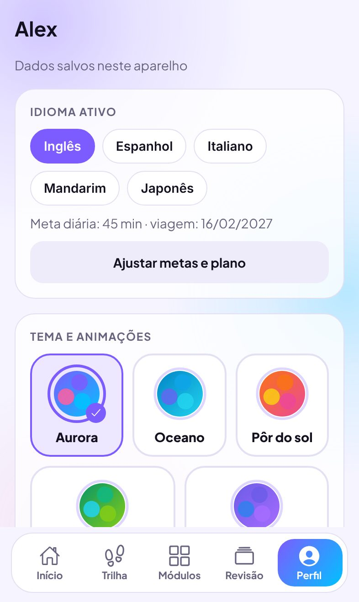
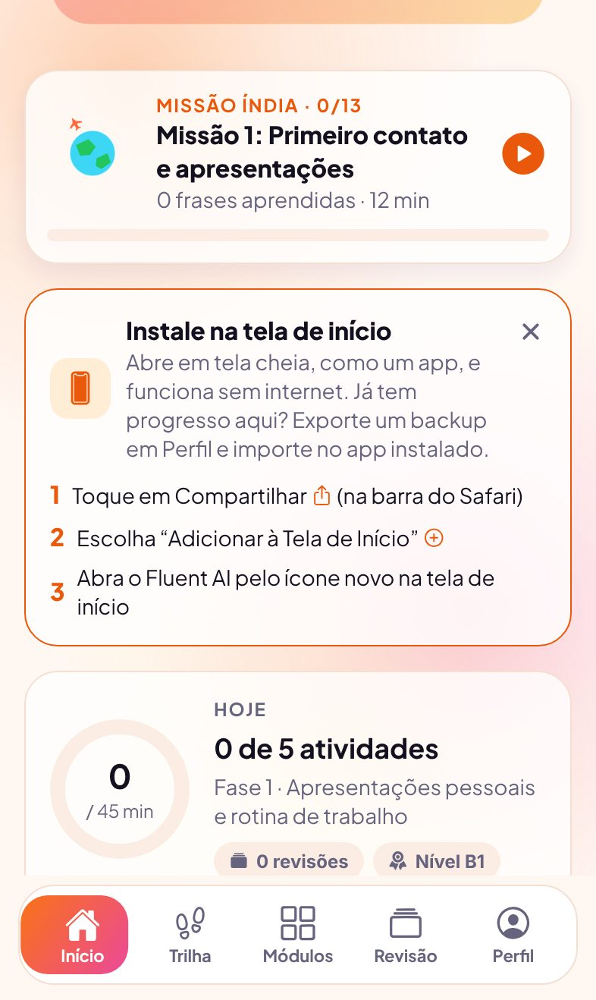

# 11. Tema, animações e interações

  
  
  
  
  

## Temas

Em **Perfil → Tema e animações**:

| Tema | Estilo |
|---|---|
| **Aurora** (padrão) | Violeta e ciano, luzes em movimento no fundo |
| **Oceano** | Azuis e turquesa |
| **Pôr do sol** | Laranja, coral e rosa |
| **Floresta** | Verdes e lima |
| **Clássico** | O visual anterior, sem luzes no fundo |

Cada tema funciona no **claro e no escuro** (ou segue o sistema). A troca é instantânea e fica salva no aparelho.

## Movimento (motion)

- **Fundo "aurora":** manchas de luz com gradiente radial que se movem devagar (Reanimated), atrás de cartões
  translúcidos ("vidro").
- **Barra de abas flutuante:** uma "pílula" em gradiente desliza com mola até a aba ativa; o ícone dá um pulo.
- **Parallax na tela inicial:** ao rolar, o card "Começar a falar agora" encolhe, inclina e esmaece; ao puxar para baixo,
  cresce.
- **Transições:** telas entram deslizando; as lições sobem de baixo; o feedback de cada exercício sobe com mola.
- **Carregamento:** animação de pontos + "esqueletos" com brilho passando, em vez de um indicador girando.
- **Microinterações já existentes:** botões e cartões que afundam ao toque, hápticos no iPhone (app nativo), contadores
  animados, anéis de progresso, flip dos flashcards, combo de acertos, confete.

## Animações no formato do After Effects (Lottie)

Todas em [`mobile/src/assets/lottie/`](../mobile/src/assets/lottie/), no formato Bodymovin (o que o After Effects
exporta) e tocadas com `lottie-react-native` (iPhone/Android) e `lottie-web` (PWA):

| Arquivo | Onde aparece |
|---|---|
| `mascot.json` — **Fluo**, o mascote do app (balão de fala que pisca e flutua) | Boas-vindas, Início, Trilha, abertura das lições |
| `mascot-cheer.json` — Fluo comemorando com estrelas | Fim das lições |
| `levelup.json` — anéis, estrela e faíscas | Fim das lições |
| `loader.json` — pontos com mola | Carregamentos |
| `success`, `confetti`, `trophy`, `flame`, `globe`, `talk` | Acertos, conquistas, sequência, Índia, boas-vindas |

O mascote e as demais animações são originais, geradas por [`mobile/scripts/make-lottie.mjs`](../mobile/scripts/make-lottie.mjs).
**Para usar animações feitas por um designer no After Effects:** exporte com o plugin Bodymovin e substitua o JSON de
mesmo nome — nenhum código precisa mudar.

## Tipografia

**Plus Jakarta Sans** (licença livre, Google Fonts) em 5 pesos, embutida no app — funciona offline.

## Acessibilidade

- **Animações reduzidas** (no Perfil) ou a preferência do sistema ("Reduzir movimento") param o fundo, as transições de
  aba e os loops do Lottie (que mostram o quadro final).
- Os textos mantêm contraste sobre o fundo animado: os cartões são translúcidos, mas com fundo suficiente.

## Para desenvolvedores

- Tokens e temas: [`mobile/src/lib/theme.ts`](../mobile/src/lib/theme.ts) (`THEMES`, `useTheme()` devolve paleta,
  gradientes do tema e `reduceMotion`).
- Componentes: `components/Aurora.tsx`, `components/AnimatedTabBar.tsx`, `components/ThemePicker.tsx`; `Skeleton` e
  `Loading` em `components/ui.tsx`; `Screen` aceita `scrollY` para parallax.

## Áudio gravado

No app web/PWA, as frases em inglês tocam a partir de arquivos MP3 gerados no deploy (`mobile/scripts/make_audio.py`),
porque a voz do sistema não é confiável no iPhone. Vozes do [Piper](https://github.com/OHF-Voice/piper1-gpl):
**LJSpeech** (inglês americano, domínio público) e, para o sotaque indiano, falantes indianos do corpus **VCTK**
(CSTR, Universidade de Edimburgo — licença CC BY 4.0).
