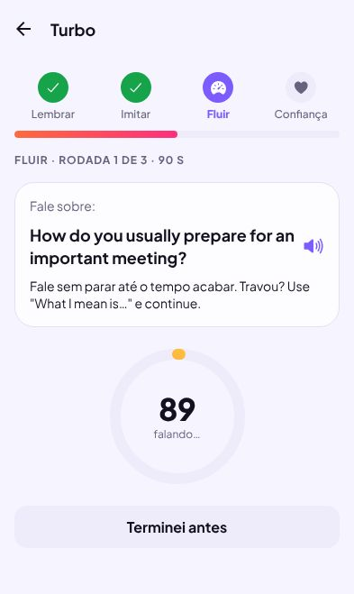

# 12. Turbo — fixar rápido e falar sem medo

  
  
  

Sessão diária de ~15 minutos (**Módulos → Turbo**, ou o card "Turbo de hoje" na tela inicial) que junta os métodos com
melhor evidência para memorizar e falar:

| Etapa | O que você faz | Base |
|---|---|---|
| **Confiança (antes)** | Diz como se sentiria falando inglês agora (1–5) | Ansiedade e autoconfiança andam juntas; ver o progresso aumenta a autoeficácia |
| **Lembrar em voz alta** | Vê o português, fala em inglês antes do círculo fechar (antecipação); a frase que não sai volta em 2 itens, "quase" em 4, a que saiu ganha 1 confirmação | Prática de recuperação + espaçamento (meta-análise em L2: efeito de médio a grande) |
| **Imitar** | Repete 3× junto com o áudio as 3 frases mais difíceis | Shadowing: ganhos de fluência e pronúncia em estudos (pequenos) |
| **Fluir (4/3/2)** | Conta a mesma história 3 vezes: 90 s, 60 s, 45 s | Técnica 4/3/2 (Nation): aumento da velocidade de fala com a repetição |
| **Confiança (depois) + desafio** | Mede de novo e recebe um desafio real pequeno, que fica mais difícil a cada 3 sessões | Exposição gradual; intervenções contra a ansiedade têm efeito moderado |

As frases vêm da sua Revisão (as que vencem hoje + novas) e voltam para ela com a nota da sessão. O histórico de
confiança fica no aparelho e aparece na abertura do Turbo.

**Limites honestos:** a maioria dos estudos é pequena; não há método milagroso. O ganho vem da combinação diária de
recuperação espaçada com muita fala de baixo risco. O app não avalia a sua pronúncia no Turbo: a autoavaliação
("saiu / quase / não saiu") é parte do método.

## Fontes
- Kim & Webb (2022), meta-análise de prática espaçada em L2 — citada em
  [Kim, tese (Western Ontario)](https://ir.lib.uwo.ca/etd/8600/).
- Nation (1989) e a técnica 4/3/2 — [resumo do Ministério da Educação da Nova Zelândia](https://tereomaori.tki.org.nz/Teacher-tools/Te-Whakaipurangi-Rauemi/Examples-of-second-language-learning-tasks/4-3-2-Maurice-1983);
  [LearnLab: fostering fluency](https://learnlab.org/research/wiki/index.php/Fostering_fluency_in_second_language_learning).
- Pimsleur (1967), "graduated interval recall" — [crítica e intervalos (CALICO)](https://www.uvic.ca/humanities/germanicslavic/assets/docs/RetentionCalico.pdf).
- Ansiedade de língua estrangeira — [revisão sistemática (Frontiers in Psychology, 2021)](https://www.frontiersin.org/journals/psychology/articles/10.3389/fpsyg.2021.614184/text);
  [meta-análise ansiedade × autoeficácia](https://repository.eduhk.hk/en/publications/foreign-language-anxiety-and-foreign-language-self-efficacy-a-met/).
- Shadowing e fluência — [tese Purdue](https://hammer.purdue.edu/articles/thesis/Effects_of_Autonomous_Shadowing_Practice_on_Oral_Fluency_Development/19606060/1).
