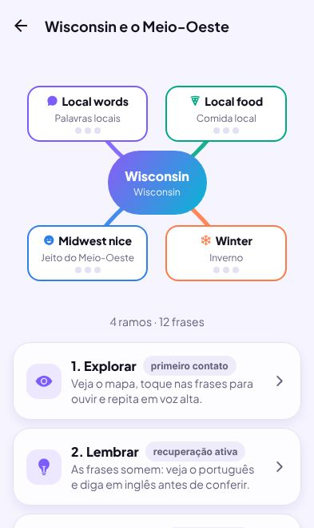

# 13. Mapas mentais e Missão Wisconsin (EUA)

  
  
  
  

## Mapas mentais (Módulos → Mapas mentais, ou o card na tela inicial)

8 mapas, cada um com um tema no centro, 4 ramos coloridos e 3 frases por ramo (96 frases, com áudio gravado):
Reuniões e calls · Explicar um problema técnico · Na fábrica · Viagem · Small talk e comida · Inglês indiano ·
Wisconsin e o Meio-Oeste · Unidades e datas nos EUA.

Nenhum método é "infalível". O desenho segue o que a pesquisa mostra que funciona melhor com mapas:

| Modo | O que você faz | Base |
|---|---|---|
| **1. Explorar** | Vê o mapa radial, toca num ramo para focar e nas frases para ouvir; repete em voz alta | Primeiro contato. Só estudar um mapa pronto ajuda pouco (Nesbit & Adesope, 2006, g ≈ 0,37) |
| **2. Lembrar** | As frases somem: vê o português e o ramo, diz em inglês (voz ou teclado), confere e se avalia. Os ramos vêm intercalados; o que não saiu volta logo | Prática de recuperação + prática intercalada. Puxar da memória rendeu ~50% mais retenção após uma semana do que montar o mapa olhando o texto (Karpicke & Blunt, 2011) |
| **3. Reconstruir** | Só com o nome do ramo, diz tudo o que lembrar; o app confere (tolerante a variações) e você corrige se ele errar | Montar o mapa de memória e depois conferir é tão eficaz quanto a recuperação livre (Blunt & Karpicke, 2014). Construir > estudar (Nesbit & Adesope, 2006, g ≈ 0,82) |

Depois de cada sessão as frases entram na revisão espaçada (FSRS) — não lembrou = volta antes — e o mapa inteiro
ganha uma data para ser reconstruído de novo (1, 3, 7, 14 e 30 dias). A lista mostra "revisar hoje" quando chega a hora.
Um mapa conta como **dominado** quando você já o reconstruiu e acertou ≥ 80%.

API: `GET /maps`, `GET /maps/{id}`, `POST /maps/{id}/complete` `{mode: study|recall|rebuild, results: [{leaf_id, rating 1–4}], duration_seconds}`.
No modo local (PWA), tudo roda no aparelho (`mobile/src/lib/local/mindMaps.ts`).

## Missão Wisconsin (Módulos → Missão Wisconsin, ou a aba "Wisconsin (EUA)" em Missões)

Mesmo formato da Missão Índia (Ouvir → Falar → Entender → Conversar), com voz americana. 6 missões, 60 frases:

1. **Chegada aos EUA** — imigração (CBP), alfândega, conexão em Chicago, aluguel de carro
2. **Carro, posto e inverno** — abastecer, gelo na pista, °F, milhas, cervos na estrada
3. **Unidades americanas na engenharia** — polegadas, "thou", libras-pé, psi, °F e datas mês/dia
4. **Small talk do Meio-Oeste** — "ope", "you betcha", "bubbler", Packers, cheese curds, fish fry
5. **Reuniões americanas** — circle back, loop in, touch base e como reconhecer um "não" educado
6. **Restaurante, gorjeta e compras** — check, split, to go, gorjeta de 18–20%, imposto somado no caixa

Cuidados de honestidade no conteúdo: expressões regionais são apresentadas como comuns na região, não como algo que
todos dizem; o app avisa que usar "you betcha" demais soa forçado. Sobre visto: brasileiros precisam de visto (B-1 para
negócios; não há ESTA para o Brasil) e o B-1 não permite trabalho remunerado nos EUA — confirme sempre em
travel.state.gov e com o RH; o app não substitui orientação consular.

API: `GET /india/missions?track=us` (o padrão continua `india`); as missões `w01`–`w06` usam os mesmos endpoints de
missão. As frases entram no FSRS com o domínio `usa`.

## Referências

- Karpicke, J. D., & Blunt, J. R. (2011). Retrieval practice produces more learning than elaborative studying with concept mapping. *Science*, 331(6018), 772–775.
- Blunt, J. R., & Karpicke, J. D. (2014). Learning with retrieval-based concept mapping. *Journal of Educational Psychology*, 106(3), 849–858.
- Nesbit, J. C., & Adesope, O. O. (2006). Learning with concept and knowledge maps: A meta-analysis. *Review of Educational Research*, 76(3), 413–448.
- Schroeder, N. L., Nesbit, J. C., Anguiano, C. J., & Adesope, O. O. (2018). Studying and constructing concept maps: A meta-analysis. *Educational Psychology Review*, 30, 431–455.
- Kim, S. K., & Webb, S. (2022). The effects of spaced practice on second language learning: A meta-analysis. *Language Learning*, 72(1), 269–319.
