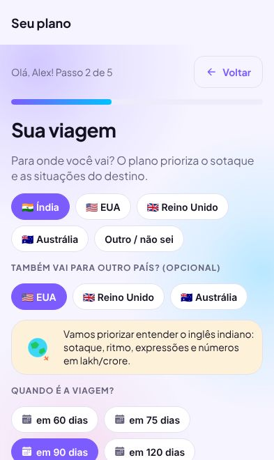
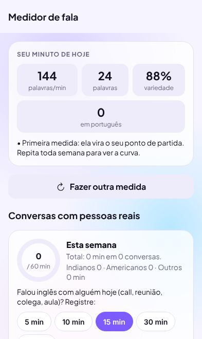
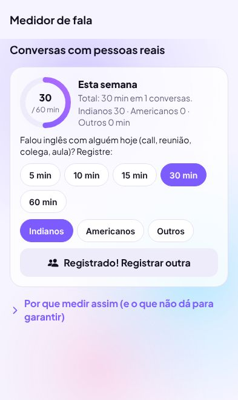

# 14. O sistema integrado: um plano diário, medido toda semana

  
  
  
  

Nenhum app consegue **garantir** que alguém fale inglês. O que dá para garantir é que o tempo de estudo vá para o que
a pesquisa mais apoia e que você veja, com números, se está funcionando. O sistema faz isso em três partes.

## 1. Um plano diário que junta tudo

O plano de 90 dias (ou até a data da viagem) agora inclui, sem você precisar escolher:

| Atividade | Quando entra | Por quê |
|---|---|---|
| Revisão espaçada (FSRS) | Todo dia, 5 min, logo no início | As revisões precisam acontecer no dia em que vencem |
| **Turbo** | Várias vezes por semana (mais na fase 1) | Recuperação em voz alta + shadowing + fluência 4/3/2 |
| **Mapa mental** | Alterna "aprender um mapa" e "reconstruir de memória" o mesmo mapa dias depois | Recuperação + espaçamento; mapas do seu destino primeiro |
| **Missão Índia / Missão Wisconsin** | Concentradas no 1º mês, depois revisadas | Frases prontas para as situações reais da viagem |
| Listening, shadowing, simulações, conversa com o tutor | Proporção muda por fase: mais ouvir no início, mais conversa no fim | Input compreensível primeiro; produção e interação crescem |
| **Medidor de fala** | 1 vez por semana (dias 7, 14, 21…), 5 min | Ver a evolução da fala com números |
| Avaliação | Dia 1 e a cada 15 dias | Ajusta o plano às suas dificuldades |

**Dois destinos:** no perfil (Perfil → Ajustar metas e plano) escolha o destino principal e, em "Também vai para outro
país?", o segundo. Com Índia + EUA, o plano inclui as duas trilhas de missões, os mapas dos dois destinos, metas
mensuráveis para cada um. Listening e tutor usam o sotaque do destino principal. O destino extra pesa 60% do principal.

Cada atividade aberta pelo plano é marcada como concluída ao terminar (Turbo, mapas, missões e medidor também).

## 2. Medidor de fala (Módulos → Medidor de fala)

Uma vez por semana: um tema (12 temas em rodízio: apresentar-se, explicar um problema, um projeto, a viagem…),
15 s para pensar e **60 s falando** (microfone ou ditado do teclado). O app calcula, a partir do texto reconhecido:

- **palavras por minuto** (velocidade de fala);
- **variedade** (palavras diferentes ÷ total);
- **palavras em português** no meio da fala;
- **tamanho médio das frases** (ideias conectadas);
- e você diz como se sentiu (1–5).

O resultado compara com a medida anterior e mostra a curva semana a semana. Limites, ditos no app: o reconhecimento
de voz erra e costuma apagar hesitações, e o tema muda a cada semana. Por isso vale a tendência de 3–4 medidas, não
um número isolado.

## 3. Conversas com pessoas reais

A prática com pessoas (calls, reuniões, colegas, aulas) é o que mais transforma estudo em fala. Ainda dentro do Medidor
de fala, você registra em 2 toques quanto tempo conversou e com quem (indianos, americanos, outros). A meta inicial
é 60 min por semana; o anel mostra o progresso da semana.

API: `GET /speaking`, `POST /speaking/checks` `{prompt_id, transcript, seconds, confidence 1–5, plan_day?, plan_activity_id?}`,
`POST /speaking/real` `{minutes 1–240, partner: india|us|other}`. As fórmulas são as mesmas no servidor (Python) e no
aparelho (TypeScript), testadas por paridade.

## O que você precisa fazer

1. Abrir o app todo dia e seguir o "Hoje" (o tempo que você escolheu no perfil).
2. Falar **em voz alta** sempre que o app pedir. Ler em silêncio não treina a fala.
3. Fazer o Medidor de fala quando ele aparecer (1×/semana).
4. Conversar com pessoas de verdade e registrar. É a parte que nenhum app substitui.
