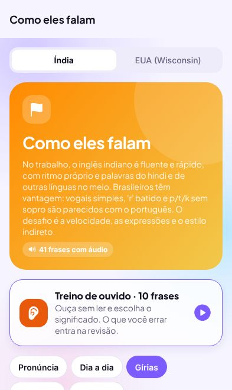
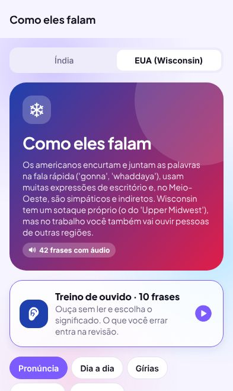
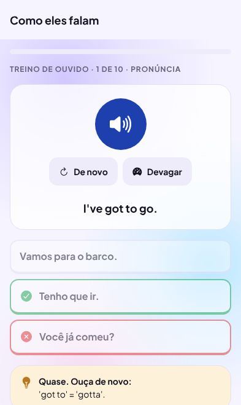

# 15. Como eles falam: pronúncia, gírias, sotaques e estilo de conversa

  
  
  

Módulos → **Como eles falam** (ou pelos cartões nas Missões). Objetivo: **entender** colegas indianos e americanos,
não imitar o sotaque. Dois guias, Índia e EUA (Wisconsin), com 83 frases com áudio gravado (voz indiana no guia da Índia,
voz americana no dos EUA):

| Aba | Índia | EUA (Wisconsin) |
|---|---|---|
| **Pronúncia** | v/w parecidos, 'th' como t/d, t/d retroflexos, ritmo silábico, 'schedule' britânico, 'double/triple' em números, 'zed' | 't' entre vogais como 'r' ('wadder'), 'Jeet yet?', 'whaddaya', 'gonna', can × can't, 'twenny', 'bag' como 'bêig', 'ô' puro do Upper Midwest |
| **Dia a dia** | 'no?' no fim, 'isn't it?', 'only/itself' de ênfase, 'Tell me', 'doubt', 'revert', 'prepone', 'out of station' | How's it going?, grab, sounds good, no worries, my bad, shoot an email, ballpark, heads-up, take it offline, swamped |
| **Gírias** | Hinglish: acha, chalo, arre, yaar, haan, bas, pakka, jugaad, -ji, tension, timepass, thik hai | ope, bubbler, you betcha, 'coming with?', uff da, brats, up north, supper, cheesehead, stop-and-go lights |
| **Conversa** | 'yes' que significa 'estou ouvindo', 'level best', 'one small request', 'Am I audible?', perguntas pessoais como simpatia | primeiro nome com todos, 'Midwest nice', muitos agradecimentos, assuntos seguros, 'I should let you go', pontualidade |
| **Sotaques** | Norte, Oeste, Sul e Leste da Índia + dicas para entender mais rápido | Upper Midwest, Milwaukee/Chicago, 'General American', Sul + dicas |

Cada frase tem: áudio normal e devagar, **"soa como"** (grafia aproximada em português), significado, dica e, nos EUA,
o botão **"Na fala rápida"**, que lê a forma reduzida ('Whaddaya wanna do?').

**Treino de ouvido:** 10 frases por rodada, intercalando as abas. Você ouve sem ler e escolhe o significado entre
3 opções da mesma aba (distratores parecidos obrigam a ouvir de verdade). Dá para ouvir de novo e devagar. As frases
entram na revisão espaçada (FSRS): errou = volta antes; acertou depois de ouvir várias vezes = "difícil". Também é possível
treinar só uma aba.

Honestidade: a voz gravada é mais clara que pessoas reais, e as expressões regionais estão marcadas como regionais (nem
todo mundo fala assim). Use o guia para saber o que esperar e complemente com conversas e vídeos reais.

API: `GET /guides`, `GET /guides/{IN|US}`, `POST /guides/{code}/complete` `{results: [{item_id, rating 1–4}], duration_seconds}`.
Conteúdo em `backend/app/content/speech_guide.py`; espelho local em `mobile/src/lib/local/speechGuide.ts`.
